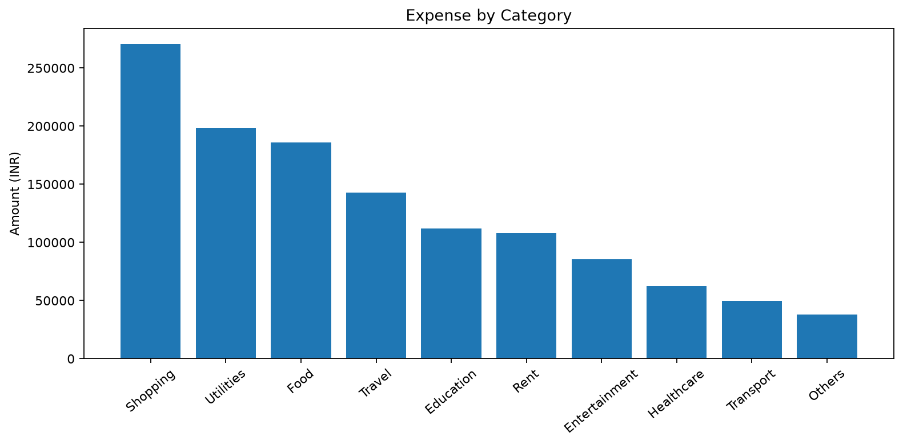
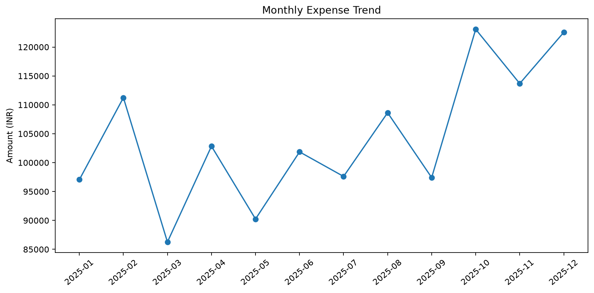
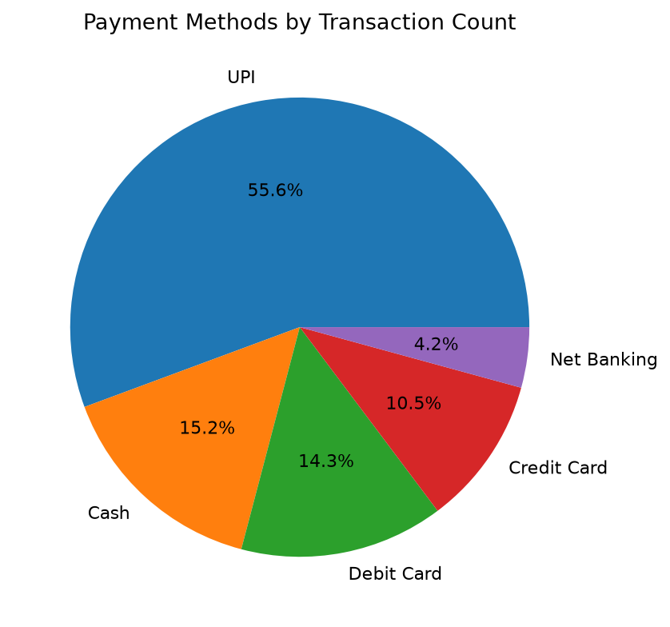
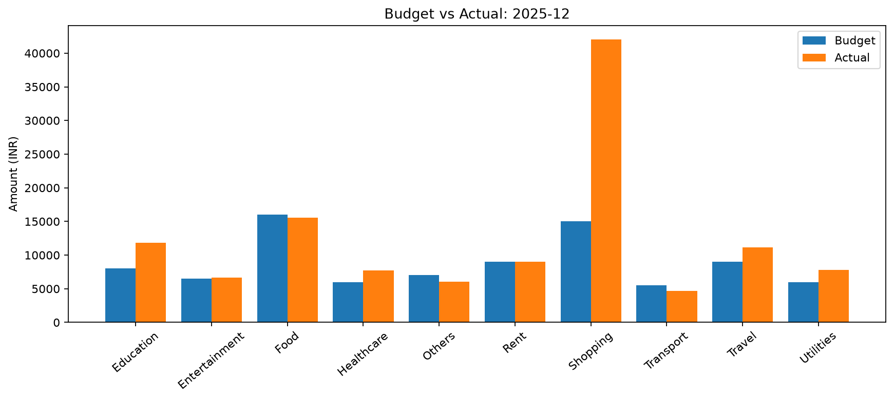

# 💰 Expense Tracker App using Data Science

**A reproducible Python financial-analytics portfolio project** featuring synthetic expense generation, data cleaning, exploratory analysis, monthly budget comparisons, rule-based insights, charts, local SQLite transaction management, and a Streamlit dashboard.

> **Data disclaimer:** All bundled transactions and results are **synthetic**, not actual customer or bank data. This is a single-user educational application, not financial advice or production banking software.

## 📌 Project Overview

This application helps users record and understand spending by category, month, and payment method. It connects a transparent data pipeline to an interactive interface and demonstrates practical skills relevant to **Data Analyst, Business Analyst, Financial Analyst, and Python Developer** roles.

### Problem Statement

Expenses recorded in scattered notes or spreadsheets are difficult to compare over time. Without organized data, users cannot easily identify high-spending categories, assess budget adherence, or understand month-to-month changes.

### Proposed Solution

Provide a local expense-tracking and analysis application that:
- Accepts manual transactions, uploaded CSV files, or reproducible synthetic demonstration data.
- Validates and standardizes transactions before analysis.
- Summarizes expenses and compares category spending with monthly budgets.
- Produces analytical reports, charts, and explainable rule-based insights.
- Allows manual records to be added, edited, and deleted in local SQLite storage.

## ✨ Key Features

- **Synthetic data:** 2,000 reproducible transactions for January–December 2025 (seed `42`), including monthly rent and simulated seasonal changes.
- **Data quality:** date, category, payment-method, and amount validation; rejected-row reporting.
- **Exploratory analysis:** category totals, monthly trends, payment-method breakdowns, weekday/weekend spending.
- **Financial KPIs:** total expenses, number of transactions, average transaction, largest expense category.
- **Budget monitoring:** category-level monthly budget, actual spending, variance, utilization, and over-budget alerts.
- **Visualization:** Matplotlib PNG charts in the batch pipeline and built-in Streamlit interactive charts in the web app.
- **Transaction management:** add, edit, and delete manually entered transactions using SQLite.
- **Exports:** processed datasets, CSV reports, chart images, and a text insights report.
- **Automated tests:** checks for reproducibility, cleaning, calculations, and edge cases.

## 🧰 Technology Stack

| Layer | Technology | Purpose |
| --- | --- | --- |
| Language | Python | Core implementation |
| Data manipulation | Pandas | Cleaning, grouping, and analysis |
| Simulation | NumPy | Reproducible synthetic expenses |
| Batch charts | Matplotlib | PNG report visualizations |
| Web dashboard | Streamlit | Interactive UI, tables, and charts |
| Persistence | SQLite (`sqlite3`) | Local manual transaction storage |
| Testing | Pytest | Analytical unit tests |
| Version control | Git + GitHub | Source history and portfolio |

## 🏗️ Architecture

```text
Synthetic generator ─┐
CSV upload ──────────┼──> Validation / cleaning ──> Pandas analytics
Manual entry ──> SQLite ┘                                │
                                                         ├──> KPI and budget reports
                                                         ├──> Matplotlib charts
                                                         ├──> Rule-based insights
                                                         └──> Streamlit dashboard
```

For additional information see [`docs/project_architecture.md`](docs/project_architecture.md), [`docs/data_dictionary.md`](docs/data_dictionary.md), and [`docs/methodology.md`](docs/methodology.md).

## 📁 Repository Structure

```text
Expense-Tracker-App/
├── data/                    # Reproducible synthetic, cleaned, and processed CSVs
├── docs/                    # Architecture, methodology, and data dictionary
├── images/                  # Generated charts and optional dashboard screenshots
├── notebooks/               # Optional exploratory notebooks
├── outputs/                 # Synthetic financial summaries and insights
├── src/                     # Generator, cleaning, analysis, budgets, charts, database
├── tests/                   # Automated tests
├── .streamlit/config.toml   # Dashboard configuration
├── .gitignore               # Excludes local databases, secrets, caches, environments
├── main.py                  # Streamlit application entry point
├── run_analysis.py          # End-to-end batch simulation and reporting
├── requirements.txt         # Python dependencies
└── README.md
```

## 🚀 Installation and How to Run

### Requirements

- Python **3.11 or 3.12** recommended
- Git (for cloning or publishing)
- Windows, macOS, or Linux

### 1. Download or clone

Download this repository as a ZIP from GitHub and extract it, or clone it:

```bash
git clone https://github.com/mohitpimpalkar27-ctrl/expense-tracker-data-science
cd expense-tracker-data-science
```


### 2. Create a virtual environment

**Windows PowerShell**

```powershell
python -m venv .venv
.\.venv\Scripts\Activate.ps1
```

**macOS / Linux**

```bash
python3 -m venv .venv
source .venv/bin/activate
```

### 3. Install dependencies

```bash
python -m pip install --upgrade pip
python -m pip install -r requirements.txt
```

### 4. Generate data, reports, and charts

```bash
python run_analysis.py
```

This regenerates the synthetic data and writes reports into `data/`, `outputs/`, and `images/`.

### 5. Run tests

```bash
python -m pytest -q
```

### 6. Launch the dashboard

```bash
python -m streamlit run main.py
```

Open the local address shown by Streamlit (typically `http://localhost:8501`).

## 🖥️ Dashboard Guide

1. **Dashboard:** review total spending, transactions, average expense, top category, and charts.
2. **Manage Expenses:** add, edit, or delete manual transactions. Choose **Manual transactions** in the dataset selector to analyze them.
3. **Analytics:** explore category, monthly, payment-method, and spending-pattern summaries.
4. **Budget Planner:** choose a month, adjust example budgets, and review actual-versus-budget results.
5. **Insights:** read data-derived category, trend, and overspending observations.

Dataset options: **Synthetic demo**, **Manual transactions**, or **Upload CSV**. Uploaded CSV data is analyzed in the current session and is **not** saved automatically to SQLite.

### CSV schema

Required columns:

```csv
transaction_id,date,category,description,amount,payment_method
EXP0001,2025-01-01,Food,Lunch,250,UPI
```

The synthetic dataset also includes a `source` column to label demo transactions. See the data dictionary for allowed values.

## 📊 Results from the Reproducible Synthetic Simulation

Results below come from the included sample run (`seed=42`, 2,000 transactions in 2025):

| Metric | Simulated result |
| --- | ---: |
| Total transactions | 2,000 |
| Total expenses | ₹12,52,478.99 |
| Average transaction | ₹626.24 |
| Largest spending category | Shopping |
| Shopping share of annual spending | 21.6% |
| December spending change vs November | +7.8% |
| December shopping overspend | ₹27,020.85 |
| Rejected generated records | 0 |

> These figures describe the **generated demonstration dataset only**. They should not be presented as real-world financial findings or predictive model accuracy.

### Financial formulas

- **Total expense** = sum of transaction amounts.
- **Category share (%)** = category total / overall total × 100.
- **Budget variance** = budget − actual; negative means overspending.
- **Budget utilization (%)** = actual / budget × 100; undefined when budget is zero.
- **Month-over-month change (%)** = (current − previous) / previous × 100; undefined when previous is zero.

## 📸 Screenshots and Charts

### Category-wise expenses


### Monthly spending trends


### Payment-method analysis


### Budget versus actual expenses


**Dashboard screenshots:** After running Streamlit, optionally add actual UI captures to `images/` and link them here. Do not present the static Matplotlib charts as screenshots of the Streamlit interface.

## 🧪 Testing

Run:

```bash
python -m pytest -q
```

The included tests cover synthetic data reproducibility, cleaning, expense aggregation, budget variance, and zero-denominator handling. They do **not** constitute complete browser-based end-to-end testing.

## 💡 Business Interpretation

In the simulated December report, shopping is materially over its illustrative budget. A business analyst could flag that category for review, examine contributing transactions, and recommend adjusting discretionary spending or revisiting the budget assumption. These are **illustrative analytical decisions**, not personalized financial advice.

## 🔒 Privacy, Assumptions, and Limitations

- All committed datasets and sample outputs must remain synthetic.
- Manual transactions are stored locally in SQLite; database files are excluded from Git.
- No account synchronization, multi-user authentication, bank integration, or encryption-at-rest is implemented.
- Budgets are illustrative, monthly, and configured in the application; do not interpret them as personalized financial targets.
- Insights use transparent **rules**, not a trained ML model.
- The simulation intentionally creates spending patterns; these do not establish real financial trends.
- CSV uploads are analyzed in the session and are not automatically persisted.

## 🔮 Possible Future Enhancements

- Expense forecasting with a properly evaluated time-series model.
- Transaction categorization using supervised learning on appropriately labeled data.
- Anomaly detection with documented false-positive trade-offs.
- Secure multi-user authentication and access controls.
- Persistent user-defined budgets and PDF exports.

## 👤 Author

**Mohit Pimpalkar**  
Computer Engineering Student | Data Analytics & Python Projects

- **GitHub:**  https://github.com/mohitpimpalkar27-ctrl
- **LinkedIn:** https://www.linkedin.com/in/mohit-pimpalkar/?isSelfProfile=true
- **Demo video:** https://youtu.be/3rvugMOy7eU?si=bQOJvgQ4jPFJ9hzx

## 📄 License

No license has been added yet. If you want to permit reuse, choose and add an appropriate license (for example, MIT) before publishing.

---

**Portfolio note:** This repository demonstrates reproducible data simulation, analytical engineering, explainable financial KPIs, a working local application, and transparent limitations—not real financial performance or investment advice.
